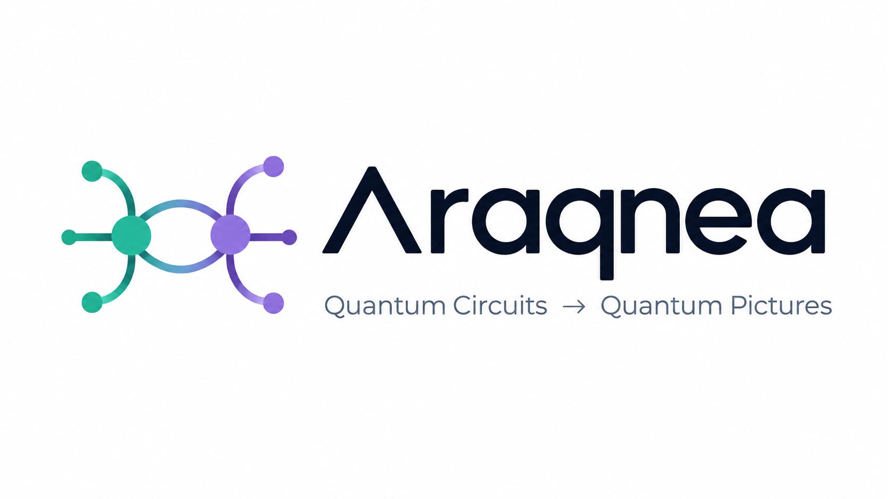

# Araqnea



Araqnea is a quantum workbench that translates OpenQASM 2.0 into synchronized gate circuits and interactive 3D ZX-calculus diagrams.

## Features

- Three synchronized workbench modes: OpenQASM editor, gate circuit, and 3D ZX graph
- Opens in **Spiders** (3D by default, switchable to 2D), with a first-visit guided UI tour (restart anytime via **Tour ✦** in the navbar) and an **About** panel
- A preset library of **48 circuits across 11 categories** — standard gates, generalized gates, Boolean logic, basis change, arithmetic, particular circuits, N-local ansatzes, data encoding, data preparation, oracles, and template circuits — available in every view
- Interactive 3D spiders with node selection, phase editing, drag-to-move, animated edges, orbit, pan, and zoom
- Angle editing in both gates and Spiders: choose **Degrees** or **Radians**, then press **Enter** or **Apply**. The editor identifies the affected gate/wire. Fixed X/Y become Rx/Ry; fixed Z/S/T become Ph. CNOT/CZ/SWAP decomposition phases and Ry basis-change spiders are read-only. Palette edits affect only the diagram until **Add to circuit** is used.
- Orthographic 2D and perspective 3D graph views with camera reset, zoom controls, box select, and a time-direction toggle (upward or rightward)
- One full-width spider canvas with node inspection and phase editing beside it; drag empty space to orbit, shift/right-drag to pan, scroll/pinch to zoom, and double-click a node to focus
- Picturalism palette of **15 symbols in three groups**, inspired by Coecke & Kissinger's *Picturing Quantum Processes* — generators (Z/X spiders, Z phase π/2, X phase π, Hadamard), states and effects (|0⟩, |+⟩, ⟨0|, ⟨+|), and wires and processes (wire, cup, cap, copy, XOR merge, discard). Drag (or click/tap) them onto the canvas; re-phase, move, or remove them from the inspector
- Connect directly on the canvas: toggle **Connect**, then click/tap a source and target (or use Tab and Enter). A preview wire and highlighted targets guide the connection; **Cancel** or Escape clears the pending source. Turn Connect off to move nodes again. Use **Disconnect** in the selected node's inspector to remove a wire you added without deleting its symbols.
- Connections reject self-links, duplicates, full Hadamard boxes, and changes to circuit boundaries. Compose states/effects and fixed-port symbols through their `out`/`in` endpoints; each port accepts one external wire. Free Z/X spiders support multiple wires. At least one endpoint must be a palette symbol, keeping circuit-to-circuit wiring managed by OpenQASM.
- Palette connections are exported in ZX graph JSON, not translated into circuit gates. Editing OpenQASM clears connections to derived circuit nodes so they cannot silently attach to a different gate; palette-only connections remain intact.
- Run the circuit from the overview panel: **Simulator** for probabilities, amplitudes and counts; **Hardware** with an API key for real-device counts
- Circuit exports for OpenQASM 2.0/3.0, Qiskit Python, PennyLane Python, a runnable Qollab project (index.html + main.js + main.css), and 3D ZX graph JSON

## Presets

Select a **Circuit / ansatz preset**, review its description, and click **Load preset**. Loading replaces and renames the active circuit; duplicate it first to keep the original. The canvas fits the new circuit while keeping the chosen 2D/3D projection. All presets are explicit gate decompositions with fixed example angles, not symbolic optimization programs or Python imports. Edit the angles in OpenQASM, the gate view, or the spider inspector, then export to either Python framework.

The library ships **48 presets in 11 categories**:

- **Standard gates**: H, X, Y, Z, S, T, RX(π/2), RZ(π/2), CX, CZ, SWAP, Measure
- **Generalized gates**: MCX (Toffoli), MCPhase, Permutation, Diagonal, Pauli evolution, Hamiltonian gate
- **Boolean logic**: AND, OR, XOR, Inner product, Bitwise XOR
- **Basis change**: QFT, Inverse QFT
- **Arithmetic**: Half adder, Full adder, Modular adder, Multiplier, Integer comparator, Linear amplitude, Functional Pauli rotation
- **Particular circuits**: Bell, GHZ, Fourier checking, Hidden linear function, IQP, Quantum volume, Phase estimation, Grover operator, Unitary overlap
- **N-local circuits**: Real amplitudes, Efficient SU2, Pauli two-design, Excitation preserving, QAOA ansatz, Evolved operator
- **Data encoding**: Z feature map, ZZ feature map, Pauli feature map
- **Data preparation**: Initialize |+⟩, Initialize |1⟩, State preparation · Bell
- **Oracles**: Phase oracle, Bit-flip oracle
- **Template circuits**: NCT 2a_1/2a_2/2a_3, Clifford H H, RZX pair

See the [Qiskit circuit library](https://quantum.cloud.ibm.com/docs/en/api/qiskit/circuit_library) and [PennyLane templates](https://docs.pennylane.ai/en/stable/introduction/templates.html) for the original parametrized templates.

## OpenQASM support

The editor accepts indexed gates `h`, `x`, `y`, `z`, `s`, `t`, `rx`, `ry`, `rz`, `u1` (also accepted as `p`), `cx`, `cz`, and `swap`, plus indexed measurements. Ph is a phase shift, `diag(1, exp(iθ))`, exported as `u1` in OpenQASM 2, `p` in OpenQASM 3/Qiskit, and `PhaseShift` in PennyLane. OpenQASM angles are always radians; the UI converts degree input before updating the source (90° = pi/2). Finite numeric/pi/tau arithmetic is accepted; division by zero is rejected. A circuit can have one quantum register and an optional single classical register; custom gate definitions, Python imports and other OpenQASM constructs are not supported.

Ry is drawn as Z(−pi/2), X(θ), Z(pi/2) in wire order. ZX circuit representations omit global phase; palette-only diagrams and wires are not automatically translated to circuit gates.

## Development

```bash
npm install
npm run dev
```

Use `npm run build` for a production build, then `npm run preview` to serve that build locally. Run `npm run lint` for static checks.
Run `npm test` for angle conversion, gate mapping, Ry decomposition, preset synchronization and export regression tests. Tests use the existing TypeScript compiler and Node test runner, with temporary output cleaned up afterward.

## Qollab package

Araqnea itself ships as a runnable Qollab JS project (separate from the in-app Qollab *circuit* export):

```bash
npm run package:qollab   # builds + zips araqnea-qollab.zip, asserting Qollab's limits
npm run verify:qollab    # Playwright parity check of the package vs npm run dev
```

`npm run build:qollab` writes three files to `dist-qollab/` following Qollab's runtime contract: a top-level `main.js` (the entry point, ~0.9 MB), a top-level `main.css` (the only stylesheet the runtime loads), and a body-only `index.html`. Upload `araqnea-qollab.zip` to Qollab to run the workbench there.

## Attribution

Araqnea is named after Arachne, the weaver of Greek mythology transformed into a spider after challenging Athena. The workbench's formal Z/X spider language comes from ZX-calculus and is inspired by *Quantum in Pictures* by Bob Coecke and Stefano Gogioso, alongside Coecke and Kissinger's *Picturing Quantum Processes*.

This effort is supported by Qollab & IonQ.
