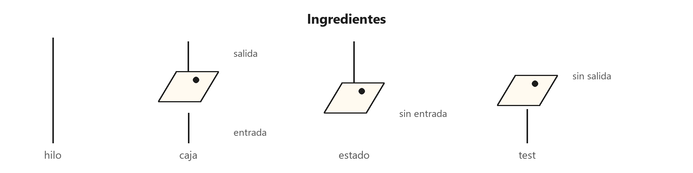
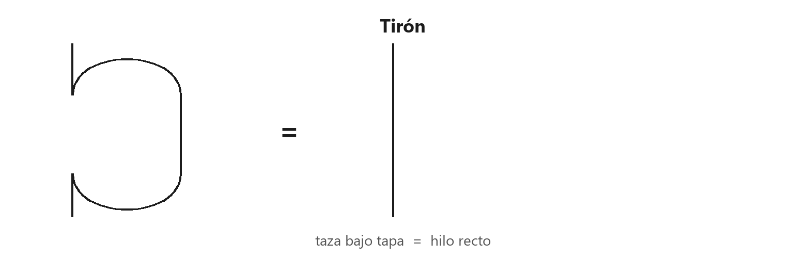
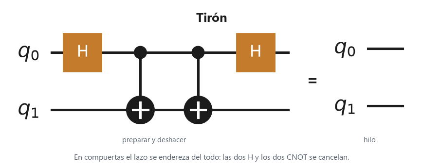
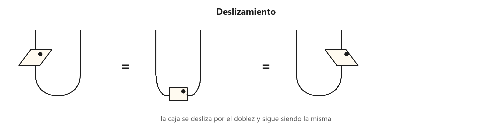
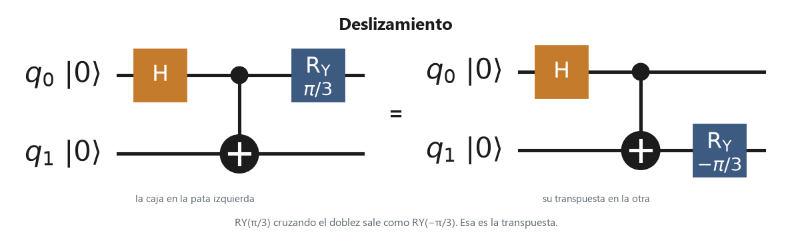
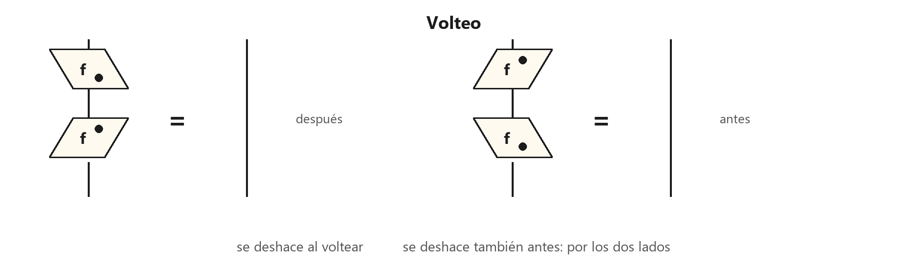
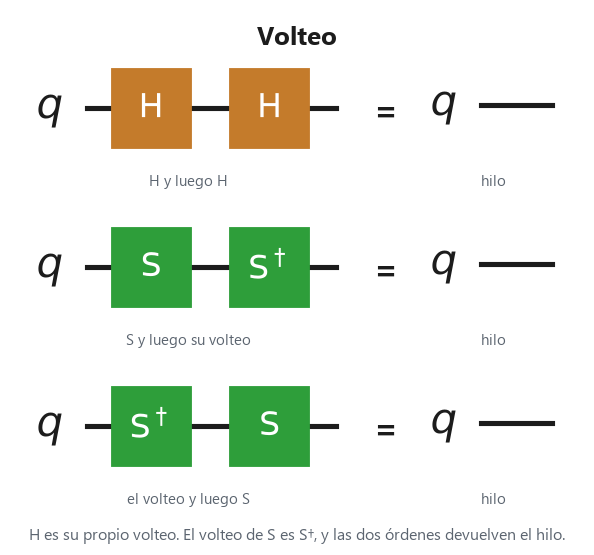
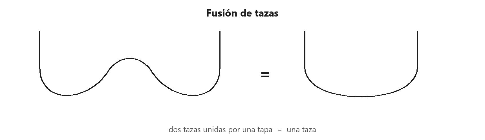
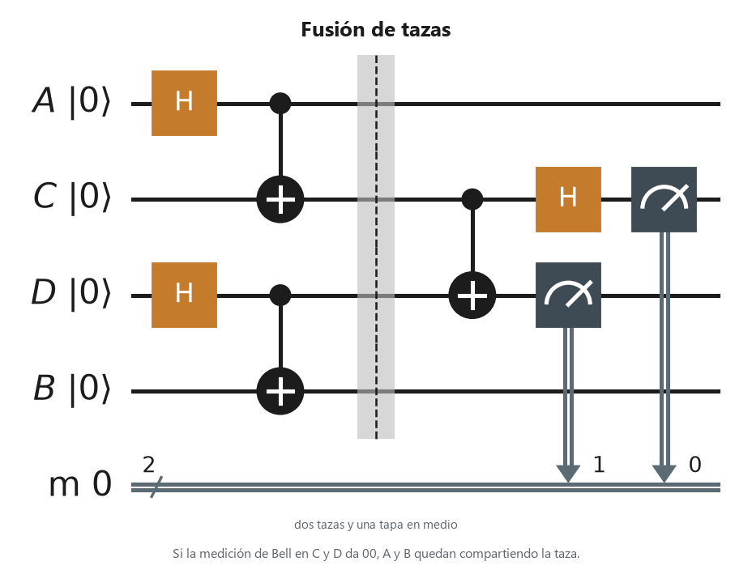

# 1. Hilos y cajas

Páginas 9–43 del PDF. Las figuras de abajo son la notación, dibujada de nuevo: no son las páginas del libro.

<p align="center"></p>

Estas cuatro piezas son el mapa del capítulo: hilo, caja, estado y test. Cada sección enseña la suya, sola.

En este capítulo una partícula cuántica es un qubit. Un qubit es un sistema con dos valores posibles, que escribimos $\ket{0}$ y $\ket{1}$. El tiempo en el dibujo va hacia arriba. Abajo está el antes. Arriba está el después. Dos dibujos dicen lo mismo cuando conectan las mismas piezas, aunque el trazo cambie de sitio en la página.

Los ejemplos usan Qiskit 2.4. Van en orden, en la misma sesión: el primero trae los imports y los demás los reutilizan. Cada pieza de abajo tiene su circuito, también de una sola pieza. En el circuito el tiempo va de izquierda a derecha: la izquierda es el antes de estos dibujos, la derecha es el después.

## No hacer nada

Imagina esa partícula cruzando la tarde sin que nadie la toque. En el papel, «no pasó nada» es un **hilo**: una raya vertical. En información cuántica ese hilo es la identidad. Entra un qubit y sale el mismo qubit, con el mismo estado.

<p align="center"></p>

La raya vertical es ese hilo. Abajo es el antes. Arriba es el después.

Un circuito vacío hace exactamente eso.

<p align="center"></p>

Qiskit empieza siempre en $\ket{0}$: de los dos valores, el de partida.

```python
import numpy as np
from qiskit import QuantumCircuit
from qiskit.quantum_info import Operator, Statevector

np.set_printoptions(precision=3, suppress=True)

hilo = QuantumCircuit(1)
print(Statevector.from_instruction(hilo).data)
print(Operator(hilo).data)
```

Deberías ver `[1, 0]` y la matriz $I$. El estado no se movió. Eso es el hilo.

$$
I = \begin{pmatrix} 1 & 0 \\ 0 & 1 \end{pmatrix}.
$$

Ese $\ket{0}$ es el vector $\begin{pmatrix} 1 \\ 0 \end{pmatrix}$. La identidad es la tabla con un $1$ en la diagonal y ceros fuera: cada valor se queda en su sitio.

## Hacer algo

Ahora sí le ocurre algo a la partícula. Una **caja** es un proceso: lo que le pasa al qubit entre el antes y el después. En información cuántica, con un qubit de entrada y uno de salida, esa caja es una matriz $2\times 2$, una tabla de cuatro números. El hilo de abajo es la entrada de esa tabla. El de arriba es la salida.

<p align="center"></p>

La caja del dibujo va sesgada, y lleva un punto. El sesgo y el punto existen para que, más adelante, se vea si la caja se ha dado la vuelta. Una caja rectangular no lo enseñaría: el punto no tendría hacia dónde señalar.

La caja más útil para empezar es la de Hadamard, $H$. Parte $\ket{0}$ en dos amplitudes iguales. Una amplitud es el número que dice cuánto hay de cada valor, antes de convertir eso en una probabilidad.

<p align="center"></p>

```python
caja = QuantumCircuit(1)
caja.h(0)

print(np.round(Operator(caja).data, 3))
print(Statevector.from_instruction(caja).data)
```

La primera impresión es la matriz de $H$. La segunda es $\ket{+}$, el nombre de ese estado partido: las dos componentes valen $1/\sqrt{2}$, cerca de `0.707`.

$$
H = \frac{1}{\sqrt{2}} \begin{pmatrix} 1 & 1 \\ 1 & -1 \end{pmatrix},
\qquad
H\ket{0} = \ket{+} = \frac{1}{\sqrt{2}} \begin{pmatrix} 1 \\ 1 \end{pmatrix}.
$$

## Un estado, un test, un número

Hay cajas a las que les falta un lado.

Un **estado** no tiene entrada. Nadie nos entrega un qubit: nosotros lo preparamos, y el hilo solo sale hacia arriba. En información cuántica, en la notación de Dirac, es un vector $\ket{\psi}$: una columna. El $\ket{0}$ del circuito vacío es un estado. $\ket{+}$, después de la caja $H$, también.

<p align="center"></p>

En el dibujo no hay hilo de abajo. El único hilo sale hacia arriba. En el circuito, ese estado es $\ket{0}$ y después $H$.

<p align="center"></p>

Un **test** no tiene salida. Es una pregunta con una sola respuesta, la que el dibujo ha elegido. En información cuántica es un efecto $\bra{\phi}$: una fila. El test $\bra{0}$ pregunta «¿estamos en $\ket{0}$?».

<p align="center"></p>

En el dibujo no hay hilo de arriba. El único hilo entra por abajo. En el circuito, el test es la medición.

<p align="center"></p>

Si conectas un estado con un test, no queda ningún hilo. El dibujo cerrado es un **número**. En información cuántica ese número es una amplitud, no todavía una probabilidad. Un test no es algo que puedas obligar: el dibujo elige una respuesta, y esa respuesta a veces no ocurre.

<p align="center"></p>

Abajo queda el estado y arriba el test. No sobra ningún hilo. En el circuito, eso es preparar y medir.

<p align="center"></p>

```python
cero = Statevector.from_label("0")
mas = Statevector.from_label("+")

amplitud = cero.inner(mas)          # <0|+>
probabilidad = abs(amplitud) ** 2

print(amplitud)
print(mas.probabilities())          # [P(0), P(1)]
print(probabilidad)
```

`cero.inner(mas)` es $\braket{0|+}$, la amplitud de hallar $\ket{+}$ cuando el test pregunta por $\ket{0}$.

$$
\braket{0|+} = \frac{1}{\sqrt{2}}.
$$

La probabilidad es el módulo al cuadrado de esa amplitud. Aquí el número es real, así que basta con elevarlo al cuadrado: $\tfrac{1}{2}$. La mitad de las veces la respuesta es que sí. La otra mitad, el test no ocurre. `probabilities()` reparte $\tfrac{1}{2}$ y $\tfrac{1}{2}$.

## Doblar el mismo hilo

Una taza, en la cocina, es un arco. Aquí también: el hilo baja y vuelve a subir, y las dos puntas quedan arriba. Esa pieza se llama **taza**. No tiene entrada. Es un estado de dos qubits. En información cuántica, la taza que el ordenador puede preparar de verdad es el estado de Bell: los dos qubits salen iguales.

<p align="center"></p>

Las dos puntas quedan arriba. Por abajo no entra nada. En el circuito, la taza es $H$ y después un CNOT.

<p align="center"></p>

La **tapa** es el mismo arco al revés: las dos puntas entran por abajo y no sale nada. Es un test de dos qubits, la pregunta que cierra esas dos puntas.

<p align="center"></p>

Las dos puntas entran por abajo. Por arriba no sale nada. En el circuito, la tapa es la medición de Bell.

<p align="center"></p>

Esos dos qubits no llevan cada uno su propia historia. Van juntos. «Juntos» quiere decir esto: si uno sale $\ket{0}$, el otro sale $\ket{0}$; si uno sale $\ket{1}$, el otro sale $\ket{1}$. No hay términos $\ket{01}$ ni $\ket{10}$. Ese vínculo se llama entrelazamiento: el valor de uno fija el del otro.

El circuito que lo prepara es una caja $H$ en el primer qubit, seguida de un CNOT. El CNOT es una caja de dos qubits: copia el bit de control en el blanco cuando el control está en $\ket{1}$. En `cx(0, 1)` el control es el qubit 0 y el blanco es el qubit 1.

```python
taza_en_el_ordenador = QuantumCircuit(2)
taza_en_el_ordenador.h(0)
taza_en_el_ordenador.cx(0, 1)

amplitudes = Statevector.from_instruction(taza_en_el_ordenador).data
print(amplitudes)
```

$$
\ket{\Phi^+} = \frac{\ket{00} + \ket{11}}{\sqrt{2}}.
$$

El vector tiene cuatro casillas, en este orden: $\ket{00}$, $\ket{01}$, $\ket{10}$, $\ket{11}$. Verás algo como `[0.707, 0, 0, 0.707]`.

El dibujo de este capítulo no pone el $1/\sqrt{2}$. Dibuja el arco desnudo, que como vector es $\ket{00} + \ket{11}$. El número que hace de eso un estado preparable espera al capítulo 6, y allí el libro lo cuenta a su manera. Hasta entonces, cuando el dibujo dice «igual», habla del arco sin ese número. Cuando el circuito habla, el $1/\sqrt{2}$ ya está dentro.

## El tirón

Pon la tapa encima de la taza, unidas por uno de los hilos. El arco se endereza y queda un hilo solo. Esa igualdad se llama **tirón**: en información cuántica, el yank, estirar el lazo hasta dejarlo recto. También vale al revés: un hilo recto se puede sustituir por ese lazo.

<p align="center"></p>

En el circuito, preparar la taza y deshacerla es la identidad: cada compuerta se cancela con la que la deshace. El un medio de más abajo aparece cuando ese número se deja fuera de las compuertas y se contraen los vectores.

<p align="center"></p>

En el dibujo, la taza bajo la tapa es el hilo recto.

El programa prepara las dos tazas. La del circuito ya trae el $1/\sqrt{2}$. La del dibujo es esa misma sin el número. En las dos comprueba el tirón.

```python
taza_en_el_ordenador = QuantumCircuit(2)
taza_en_el_ordenador.h(0)
taza_en_el_ordenador.cx(0, 1)

preparado = Statevector.from_instruction(taza_en_el_ordenador).data
arco_del_dibujo = preparado * np.sqrt(2)   # quita el 1/sqrt(2)


def tiron(vector_de_cuatro):
    tabla = vector_de_cuatro.reshape(2, 2)
    return tabla.conj().T @ tabla


print(tiron(arco_del_dibujo).real)   # I
print(tiron(preparado).real)         # I/2
```

La primera impresión es $I$. La segunda es $\tfrac{1}{2}I$.

La tabla $2\times 2$ es el arco leído como matriz. Multiplicarla por su volteo es conectar la tapa con la taza.

Con la taza del dibujo, sin el $1/\sqrt{2}$, el tirón es exacto. Si $T = \ket{00} + \ket{11}$,

$$
(T^{\dagger})\, T = I.
$$

La tapa es el volteo de la taza, $T^{\dagger}$. Contraer el hilo compartido devuelve la identidad: la partícula sale como entró.

Con el estado que prepara el circuito, los dos factores $1/\sqrt{2}$ se multiplican y queda

$$
(\Phi^+)^{\dagger}\Phi^+ = \tfrac{1}{2}I.
$$

Ese $\tfrac{1}{2}$ no se tira. Es la razón por la que el capítulo 6 va a dejar de ignorar los números. Aquí solo lo dejamos escrito.

## La caja viaja por el doblez

El hilo doblado sigue siendo un hilo: es el mismo trazo, con una curva. Una caja puede recorrer el arco y salir al otro lado. Sigue siendo la misma caja. El punto del dibujo viaja con ella, y por eso se ve que no se ha vuelto otra. Una caja rectangular no lo enseñaría.

<p align="center"></p>

La caja del ejemplo es $\mathrm{R}_Y(\pi/3)$. Al otro lado del doblez queda $\mathrm{R}_Y(-\pi/3)$, que es su transpuesta.

<p align="center"></p>

En el dibujo el punto cruza el doblez y la caja sigue siendo la misma. Doblar a la vez la entrada y la salida gira la caja 180°. En información cuántica ese giro es la transpuesta, $A^{\mathsf{T}}$: las filas de la tabla pasan a ser columnas. Si la caja tiene varias patas, cada pata se dobla con su taza o su tapa.

## Dar la vuelta, y poder deshacer

El **volteo vertical** es el reflejo de arriba abajo. En información cuántica es el adjunto $A^{\dagger}$: primero la transpuesta, y además se conjugan los números. Conjugar cambia cada $a+bi$ por $a-bi$. Si la matriz es real, como $H$, no hay parte imaginaria, conjugar no cambia nada y el adjunto coincide con la transpuesta. Con números complejos no coinciden. Son dos operaciones distintas.

Conectar el volteo **después** de la caja y obtener el hilo identidad es poder deshacer el proceso: lo que la caja hizo, el volteo lo deshace. Si además se puede conectar el volteo **antes**, y también da el hilo, la caja se deshace por los dos lados.

<p align="center"></p>

En circuito, el volteo de $H$ es la misma $H$. El de $S$ es $S^\dagger$, y las dos órdenes devuelven el hilo.

<p align="center"></p>

A la izquierda, el volteo va después de la caja y el resultado es el hilo. A la derecha, el volteo va antes y también queda el hilo.

$H$ se deshace por los dos lados, y de hecho $H^{\dagger} = H$: aplicarla dos veces devuelve el hilo. El programa multiplica $H$ por su adjunto en los dos órdenes.

```python
H = Operator.from_label("H").data
print(np.round(H.conj().T @ H, 10))   # I
print(np.round(H @ H.conj().T, 10))   # I
```

Las dos impresiones son $I$.

En información cuántica, deshacer el proceso conectando el volteo después es una isometría:

$$
A^{\dagger} A = I.
$$

Si además se deshace al conectar el volteo antes, es unitaria:

$$
A^{\dagger} A = I \qquad\text{y}\qquad A A^{\dagger} = I.
$$

Lo segundo implica lo primero. Una isometría no tiene por qué ser unitaria: poder deshacer después no garantiza poder deshacer antes.

Una caja que solo se deshace después: meter el qubit en un espacio más grande, $\ket{\psi} \mapsto \ket{\psi}\ket{0}$, pegándole un $\ket{0}$ extra. Se puede deshacer tirando ese $\ket{0}$. No se puede deshacer al revés, porque un estado de dos qubits cualquiera no tiene por qué traer ese $\ket{0}$. En matrices, con filas $\ket{00},\ket{01},\ket{10},\ket{11}$,

$$
V = \begin{pmatrix} 1 & 0 \\ 0 & 0 \\ 0 & 1 \\ 0 & 0 \end{pmatrix},
\qquad
V^{\dagger} V = I_2,
\qquad
V V^{\dagger} \neq I_4.
$$

## Dos tazas se funden

Dos tazas unidas por una tapa en el medio son una sola taza. Es el tirón leído en horizontal: el mismo lazo, enderezado de lado.

<p align="center"></p>

Dos tazas y la tapa en el medio, en el orden del circuito. Si la medición de $C$ y $D$ da $00$, $A$ y $B$ comparten la taza.

<p align="center"></p>

En el dibujo, la tapa del medio deja una sola taza. En información cuántica esa igualdad se llama intercambio de entrelazamiento. Hay tres personas. Andrea comparte una taza con Chi, Blaise comparte otra taza con Chi, y la tapa en Chi deja a Andrea y a Blaise compartiendo una taza entre ellos.

Ese protocolo se llama teleportation. Es el mismo dibujo con un estado enchufado en una pata. Andrea tiene $\ket{\psi}$ y una pata de la taza. Aplica la tapa a esas dos patas. Si ese test ocurre, el tirón dice que la partícula de Blaise queda en $\ket{\psi}$.

Esa tapa es uno de los cuatro resultados de una medición de Bell: la pregunta, sobre dos qubits, que distingue los cuatro pares posibles. No ocurre siempre. En el protocolo completo cada resultado tiene probabilidad $\tfrac{1}{4}$, y en los otros tres Blaise tiene que corregir. Quedarse solo con el resultado que endereza el hilo es una postselección: el libro llama a eso una caja tal vez, una caja que solo a veces ocurre. El capítulo 3 explica qué hace falta para que el protocolo ocurra siempre, aviso incluido. De aquí no se sigue que $\ket{\psi}$ llegue con certeza.
