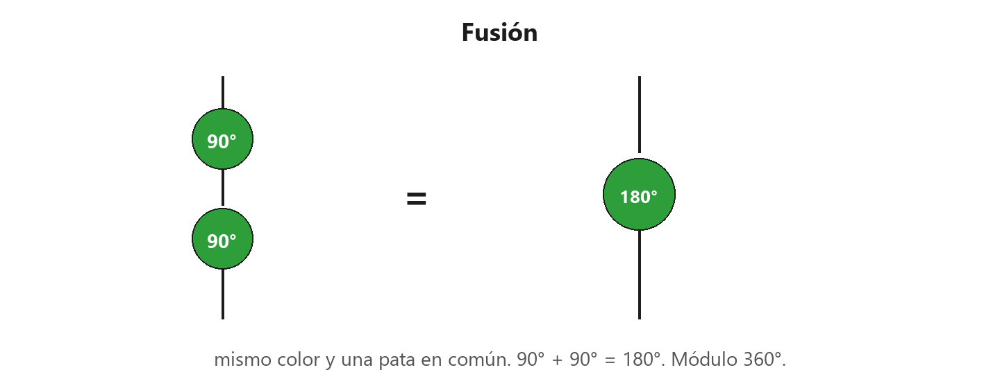
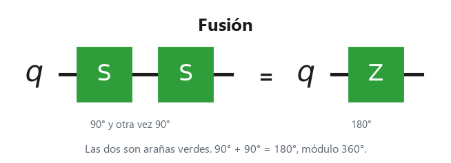
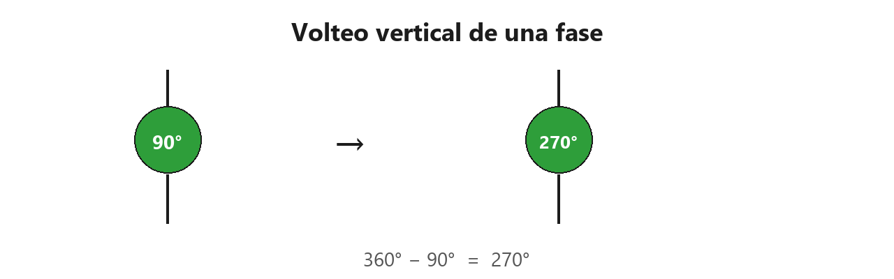
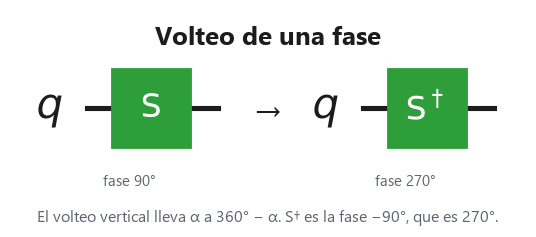
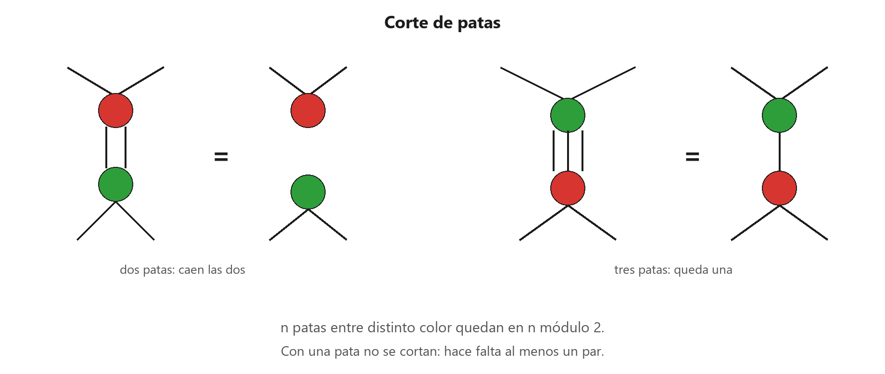
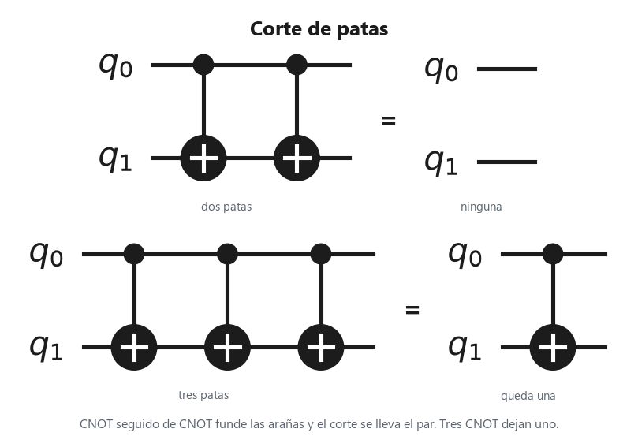
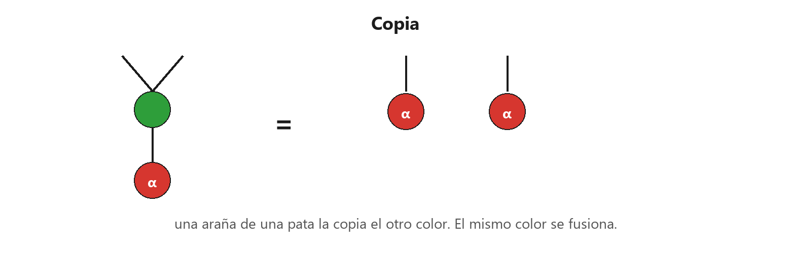
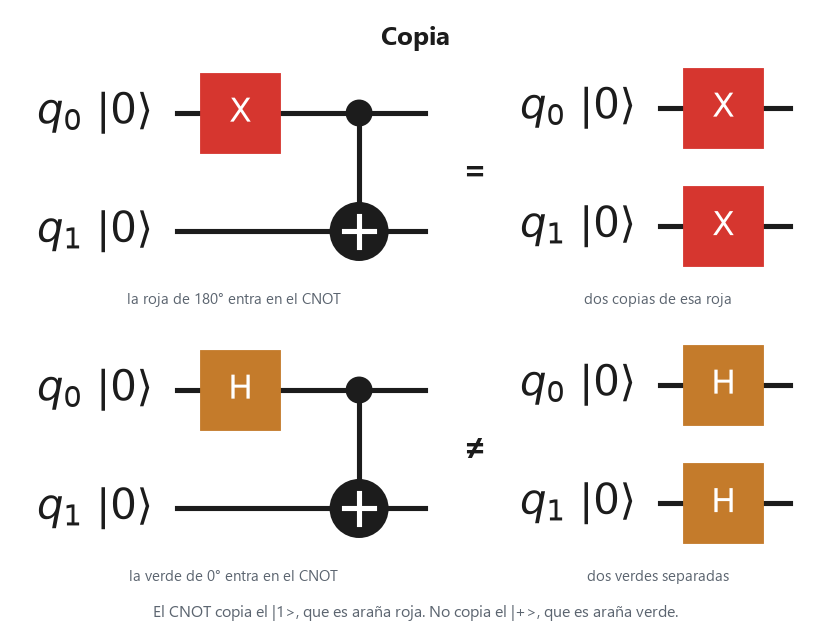
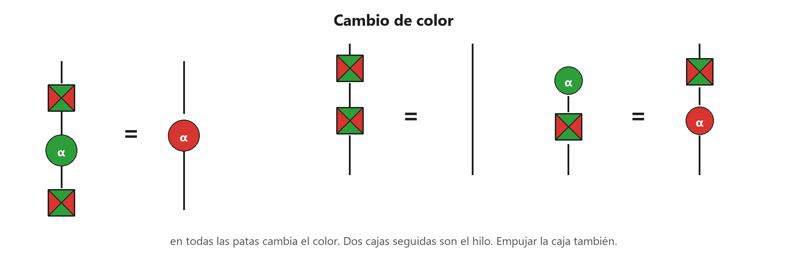
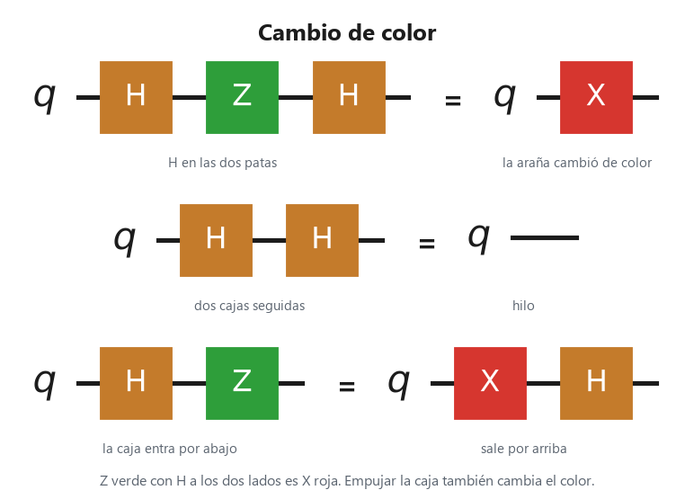

# 2. Un mundo de arañas

Páginas 44–82. Una **araña** es una caja cuyas patas son todas el mismo tipo de hilo. Hay arañas verdes y arañas rojas. En información cuántica la verde es la familia Z y la roja es la familia X. La fase es un ángulo escrito en la araña. Sin marca, la fase es 0°. Las sumas se toman módulo 360°: al llegar a 360° se vuelve a cero.

En los circuitos, verde es Z, rojo es X y ámbar es Hadamard. El tiempo del dibujo va hacia arriba. El del circuito va de izquierda a derecha: la izquierda es el antes, la derecha es el después.

## Fusión

Dos arañas del mismo color que se tocan por al menos una pata se funden en una sola. En información cuántica las fases se suman. $S$ es la araña verde de 90°. Dos seguidas son $Z$, la verde de 180°.

En el dibujo, la pata compartida desaparece y las otras se juntan. 90° + 90° queda en 180°.

La igualdad leída al revés es la desfusión: una araña se parte en dos del mismo color, y las patas se reparten como se quiera. Distinto color no se fusiona. Sin una pata en común, tampoco.

El **volteo vertical** de una araña sigue siendo una araña. En información cuántica la fase $\alpha$ pasa a ser $360° - \alpha$. El volteo de $S$, que es 90°, es $S^\dagger$, que es 270°.

A la izquierda la araña marca 90°. A la derecha, la misma araña marca 270°.

## Fase 0°

Una araña de fase 0° con una entrada y una salida es el **hilo**, y se quita. En información cuántica es la identidad.

La araña de 0° con una pata abajo y una arriba es la raya vertical.

En el circuito esa araña se borra: no queda ninguna compuerta.

Con dos salidas es la **taza**. No es el hilo.

Dos patas arriba son el arco. Por abajo no entra nada.

En el circuito, la taza es $H$ y después un CNOT.

Con dos entradas es la **tapa**. Tampoco es el hilo.

Dos patas abajo cierran el arco. Por arriba no sale nada.

En el circuito, la tapa es la medición de Bell. El tirón del capítulo 1 es esta misma fusión, leída en el arco.

## Corte de patas

Una araña verde y una roja unidas por varias patas no se fusionan: el color no coincide. Lo que sí ocurre es el **corte de patas**. En información cuántica, $n$ patas entre distinto color quedan en $n$ módulo 2. Par: se separan. Impar: queda una pata. Con una sola pata no hay par que cortar.

A la izquierda, dos patas entre verde y roja caen las dos. A la derecha, tres patas dejan una.

Dos CNOT seguidos se cancelan: el par de patas desaparece. Tres dejan un CNOT.

## Copia

Una araña de una sola pata la copia una araña del otro color. En información cuántica eso no es una caja que copie cualquier estado del qubit. Las copias pueden salir en cualquier dirección. El mismo color no copia: se fusiona.

La araña verde parte en dos a la araña roja de una pata. Si las dos fueran del mismo color, se fundirían en una.

El $\ket{1}$ es la araña roja de 180°, y el CNOT la copia. El $\ket{+}$ es la araña verde de 0°, y el mismo CNOT no la parte en dos.

## Cambio de color

La **caja de cambio de color** es Hadamard. En información cuántica, puesta en todas las patas de una araña, cambia el verde por rojo y deja la fase. Dos cajas seguidas son el hilo, y la caja se deshace al voltear por los dos lados. Empujarla a través de la araña también cambia el color, y deja una caja en cada pata por donde no entró.

En todas las patas, la verde de fase $\alpha$ pasa a roja de la misma fase. Dos cajas seguidas en el mismo hilo desaparecen. De abajo arriba, caja y luego verde es lo mismo que rojo y luego caja.

$H$ a los dos lados de $Z$ deja $X$. Dos $H$ seguidas son el hilo. $H$ y después $Z$ es lo mismo que $X$ y después $H$.

## Puertas

Una araña de dos patas y fase $\alpha$ es una puerta de fase. La roja de 180° es la puerta $X$. En información cuántica manda el estado rojo de 0° al de 180°, y otra vez lo devuelve, porque 180° + 180° = 360° = 0°.

Una sola araña roja, con 180° escrito, y una pata abajo y otra arriba.

En el circuito esa araña es $X$.

El CNOT es la araña verde unida por una pata a la araña roja, las dos de fase 0°. El control es la verde. El blanco es la roja.

Las dos arañas comparten una pata horizontal. Cada una sigue su hilo hacia arriba.

