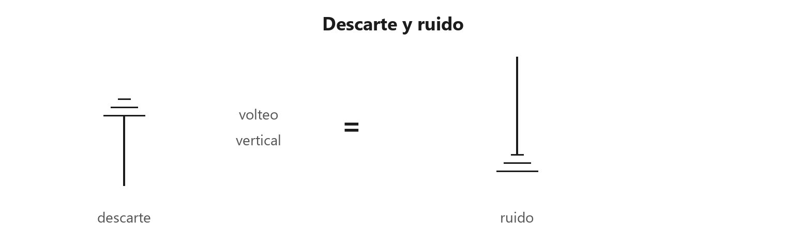
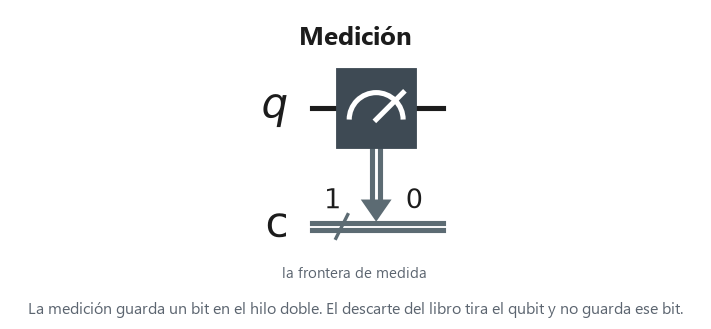
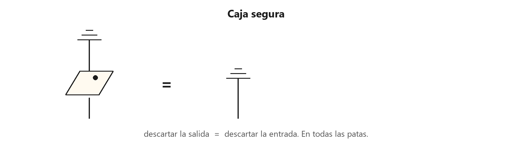
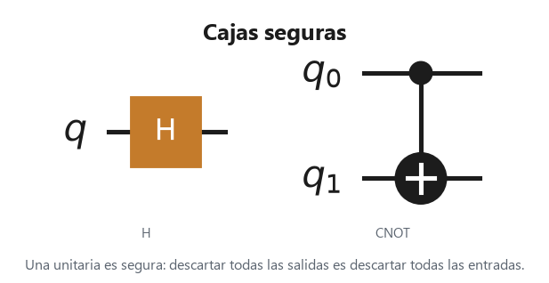
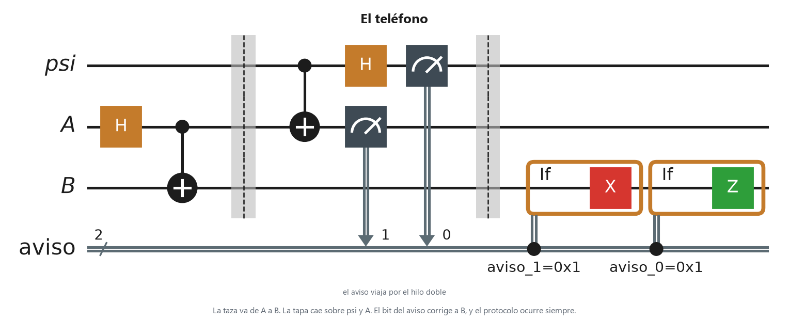

# 3. Mantener contento a Einstein

Páginas 83–100. Este capítulo separa lo que ocurre siempre de lo que ocurre solo a veces. Una **caja segura** ocurre siempre. Una **caja tal vez** ocurre solo si el test que la cierra da la respuesta que el dibujo eligió.

En los circuitos el tiempo va de izquierda a derecha. El hilo doble del circuito es el hilo ordinario del dibujo: por ahí viaja un bit, no un qubit.

## Descarte y ruido

Cada tipo de partícula tiene un test de **descarte**. En información cuántica es el test que ocurre siempre: tira el qubit y no guarda un resultado. Descartar varios hilos es descartar cada uno. Descartar ninguno es el diagrama vacío. El volteo horizontal no lo cambia. El volteo vertical, y también la rotación de 180°, dan el mismo estado: el **ruido**.

A la izquierda está el descarte. Voltearlo en vertical da el ruido de la derecha: el mismo dibujo, ahora como estado, con el hilo hacia arriba.

El descarte no es una compuerta. En el circuito, la frontera que sí se dibuja es la medición, y esa guarda el bit en el hilo doble. Guardar el bit no es tirarlo.

## Caja segura

Una caja es **segura** cuando descartar todas las salidas es igual a descartar todas las entradas. En información cuántica, un test es seguro solo si es el descarte. El descarte es el único test seguro. El test de 0°, verde o rojo, no lo es.

Descartar la salida de la caja deja el mismo dibujo que descartar la entrada. Tiene que pasar en todas las patas, no en una sola.

$H$ y el CNOT son cajas seguras: son unitarias. Descartar lo que sale es descartar lo que entró.

## La suma de casos, y la tapa

El signo $+$ junta alternativas de las que ocurre una, sin elegir cuál. En información cuántica, el test de 0° y el de 180° del mismo color, sumados, son el descarte. Sobre dos partículas, los cuatro pares —verde en una, rojo en la otra— forman una caja segura.

El test de 0° más el de 180° es el descarte. Uno de los dos ocurre, y entre los dos cubren todas las respuestas.

Medir cada qubit en $Z$ junta ese test de 0° y el de 180°.

La **tapa** no es ese descarte. Si lo fuera, al doblar una pata todo hilo quedaría roto.

A la izquierda el arco cierra dos hilos. A la derecha, descartar cada hilo por separado. No son el mismo dibujo.

La tapa mide los dos hilos juntos. Esa pregunta no es medir cada qubit en $Z$.

## El teléfono

El teleportation del capítulo 1 usa una tapa: es una caja tal vez. Para que el protocolo sea seguro, los cuatro tests van sumados y el resultado viaja por un hilo ordinario. Ese hilo es el aviso. Sin ese aviso, lo que llega al otro extremo es ruido. De este capítulo no se sigue que un estado cruce el espacio sin ese hilo ordinario.

La taza va de $A$ a $B$. La tapa cae sobre $\psi$ y $A$. El bit del aviso corrige a $B$, y el protocolo ocurre siempre. Si el bit que sale de $A$ es 1, $B$ recibe $X$. Si el bit que sale de $\psi$ es 1, $B$ recibe $Z$.
