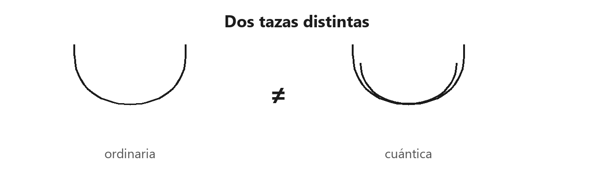
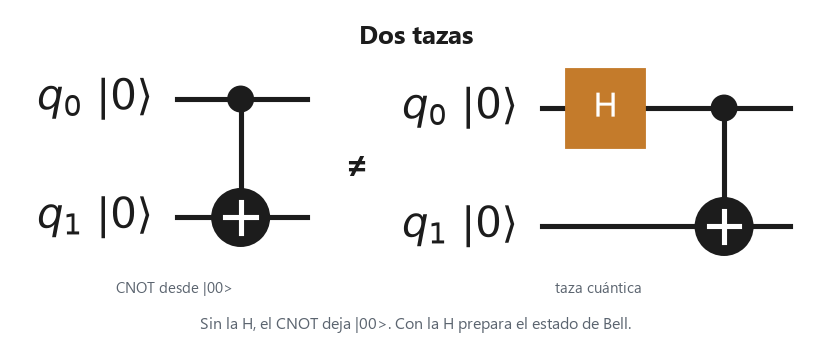
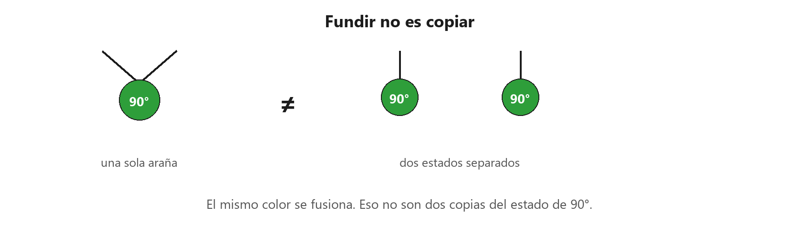
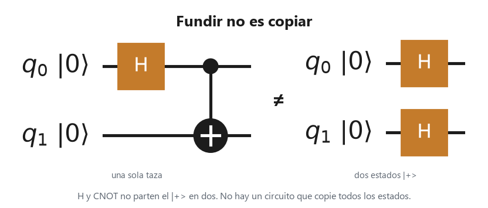

# 4. Partículas cuánticas y ordinarias

Páginas 101–138. El **hilo ordinario** es un solo trazo: lleva un bit. El **hilo cuántico** es un trazo doble: lleva un qubit. En información cuántica, una caja cuántica es una caja junto a su volteo horizontal. Al doblar una araña, la copia lleva la fase $360° - \alpha$.

En el circuito, el hilo doble es el ordinario. El tiempo va de izquierda a derecha.

## Medición y codificación

La **medición** es una araña con dos patas de entrada, leídas como un hilo cuántico, y una pata de salida ordinaria.

El hilo doble entra por abajo. Por arriba sale un solo trazo: el bit.

La **codificación** es el volteo vertical de esa medición. En información cuántica escribe el bit otra vez en un qubit: si vale 1, aplica $X$.

El hilo ordinario entra por abajo. Por arriba sale el hilo doble.

Codificar y medir en el mismo color es la identidad ordinaria, por fusión.

La codificación y la medición, una detrás de la otra, se funden en el hilo de un solo trazo.

## Dos tazas

La **taza ordinaria** y la **taza cuántica** no son el mismo estado. La ordinaria es un bit repetido en un hilo de un solo trazo. La cuántica es el arco del capítulo 1, el estado de Bell.

Un arco es de trazo simple y el otro es de trazo doble. Comparten la forma y no el tipo de hilo.

El CNOT solo, desde $\ket{00}$, deja $\ket{00}$. Con $H$ delante es la taza cuántica.

El **descarte ordinario** es una araña: copiar un hilo ordinario y descartar una copia es no hacer nada. El **descarte cuántico** es el descarte ordinario enchufado a la medición. Como la medición es segura, descartar su salida ordinaria es descartar su entrada cuántica. Ese descarte cuántico es una tapa sobre el hilo doble.

## No hay copia cuántica

La copia del capítulo 2 copia arañas de una pata del otro color. Así se copian los bits que ya están codificados. No copia un estado de fase del mismo color. En información cuántica, ninguna caja es una copia de todos los estados de un qubit.

Una araña verde de 90° con dos salidas es una sola araña. Dos estados verdes de 90°, separados, son otra cosa.

$H$ y CNOT preparan una taza. Dos $H$ preparan dos $\ket{+}$. Son estados distintos.

Ninguna caja cumple las dos ecuaciones de una copia cuántica. Al pedirlas junto al descarte cuántico, la caja queda partida, y un lado recibe algo que no depende de lo enviado.

## Con fugas y sin fugas

Una caja **tiene fugas** cuando en su interior aparece un descarte: se pierde un hilo cuántico. En información cuántica, el descarte, el borrado de fase y el ruido cuántico tienen fugas. El **borrado de fase** es medir y olvidar el resultado: se mide y se vuelve a codificar, y la fase no llega al qubit nuevo.

El hilo doble entra, pasa por la medición y sale ordinario. La codificación lo vuelve a doblar. La fase que traía no está en el qubit de arriba.

Una caja **sin fugas** no esconde ese descarte. Una caja segura y sin fugas se deshace al voltear. Nada cuántico se pierde en ella.
