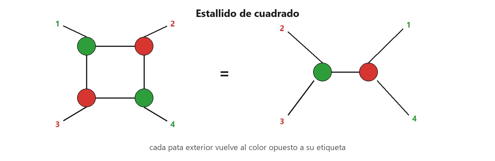
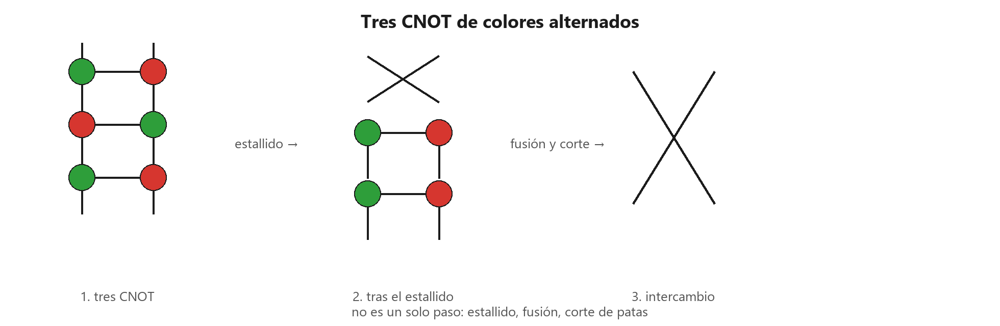
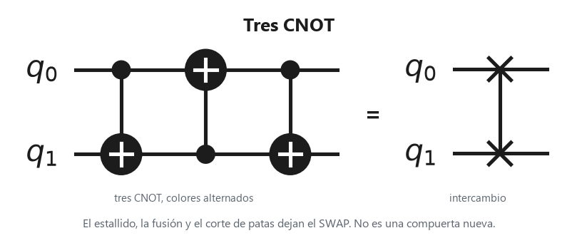
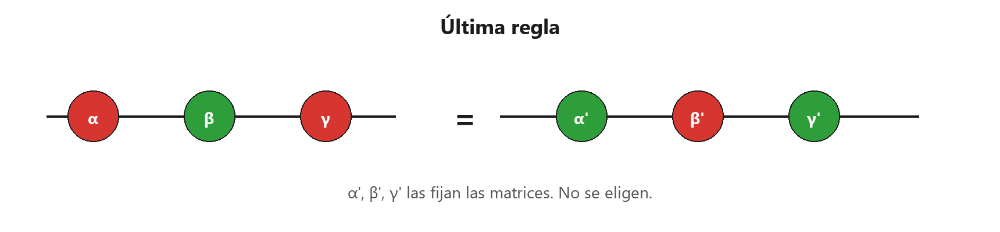
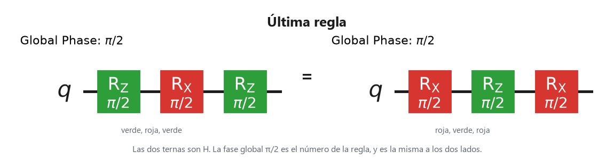

# 5. Todo a partir de dibujos

Páginas 139–158. La fusión junta arañas del mismo color. El corte de patas actúa cuando el color es distinto y hay un par de patas. Este capítulo cierra lo que esas dos reglas no alcanzan.

En el circuito el tiempo va de izquierda a derecha.

## Estallido de cuadrado

Cuatro arañas en ciclo, de colores alternados, cada vecina unida por una sola pata, no se fusionan: no hay dos del mismo color pegadas. Tampoco se les cortan patas: no comparten dos. El **estallido de cuadrado** sustituye ese ciclo por dos arañas que comparten una pata. En información cuántica, cada pata exterior vuelve a la araña de color opuesto al de la araña de la que salía.

Las patas llevan el número y el color de la araña de la que salen. La pata 1, que salía de una verde, vuelve a la roja. La 2, que salía de una roja, vuelve a la verde. Igual la 3 y la 4.

El estallido implica el corte de patas. El corte puede citarse solo, sin volver a dibujar el ciclo.

Un cuadrado a veces no parece un cuadrado. Tras fundir y desfusión, el mismo paso deja un gadget de fase: una araña de fase colgando de un hilo entre dos arañas. En compuertas, el caso que este capítulo cierra con el estallido es el intercambio de la sección siguiente.

## Tres CNOT

Tres CNOT de colores alternados son el intercambio de los dos hilos. En información cuántica eso no es una regla nueva: es el estallido, luego la fusión de lo que queda, y el corte de patas.

La figura tiene tres pasos, y no son uno solo. Primero, tres CNOT de colores alternados. Después, el estallido. Al final, la fusión y el corte dejan los dos hilos cruzados.

A la izquierda, tres CNOT. A la derecha, el intercambio. Son la misma matriz.

## Última regla

Tres puertas de fase de colores alternos no salen ni por corte de patas ni por estallido. La **última regla** intercambia los colores y cambia las tres fases. En información cuántica, $\alpha'$, $\beta'$ y $\gamma'$ salen de igualar las matrices, fase global incluida. No se elige una terna a ojo.

A la izquierda, roja, verde y roja. A la derecha, verde, roja y verde. Las fases del otro lado no son las de partida.

$H$ partida en verde, roja y verde es la misma $H$ partida en roja, verde y roja. El $\pi/2$ de arriba es la fase global, y coincide a los dos lados.

Las fases nuevas se leen en estas matrices, con la fase del libro:

- verde($\alpha$) = $\ket{0}\bra{0} + e^{i\alpha}\ket{1}\bra{1}$
- rojo($\alpha$) = $\ket{+}\bra{+} + e^{i\alpha}\ket{-}\bra{-}$

Si la fase global no es 1, se escribe como número. Con esta regla, el libro trata el cálculo como suficiente para las igualdades de la teoría cuántica de qubits. Este resumen no añade otra regla.
