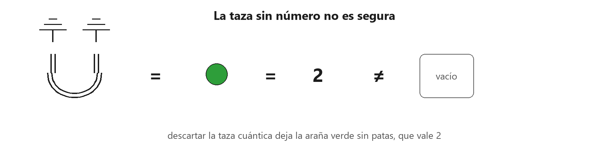
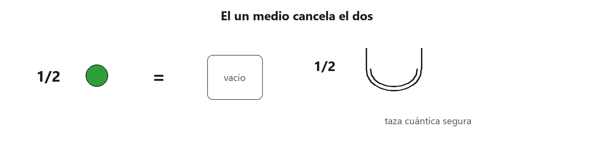
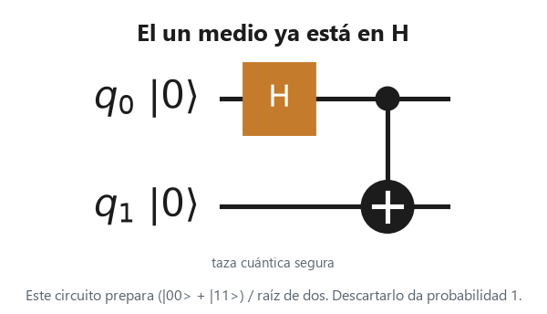
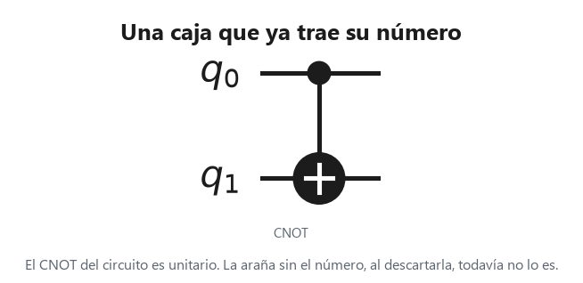

# 6. Probabilidades a partir de dibujos

Páginas 159–173. Un **número** es un diagrama sin entradas ni salidas. Hasta aquí el libro los ignoraba a propósito. En cuanto se habla de certeza, de «siempre» o de dos diagramas iguales, ese número cuenta.

La probabilidad de un estado se obtiene descartando su salida. Un estado seguro tiene probabilidad 1.

En el circuito el tiempo va de izquierda a derecha. El $1/\sqrt{2}$ que el dibujo venía dejando fuera ya está dentro de $H$.

## La trampa

Descartar las dos salidas de la taza cuántica, tal como se venía dibujando, no da el diagrama vacío. Da la araña verde sin patas. En información cuántica esa araña es el número 2. 2 no es 1, así que esa taza no es un estado seguro.

La taza del dibujo no lleva el $1/2$. Al descartar las dos salidas queda un punto verde suelto, sin patas: el 2, no el diagrama vacío.

## El un medio

1 partido por la araña verde sin patas es $1/2$, y cancela un 2 cuando se encuentran. La taza cuántica con ese $1/2$ al lado sí es un estado seguro: al descartarla queda el diagrama vacío, que aquí es el 1.

A la izquierda, $1/2$ junto a la araña verde sin patas es el diagrama vacío. A la derecha, ese mismo $1/2$ va junto a la taza cuántica, y esa taza ya es segura.

En el circuito ese un medio ya está dentro de $H$. La taza que prepara es $\left(\ket{00}+\ket{11}\right)/\sqrt{2}$, y descartarla da probabilidad 1.

Lo mismo le pasa al CNOT. Para que sea una caja segura lleva su número. Si al descartar aparece un 4, la ecuación se divide por 4, que son dos arañas verdes sin patas. Dos diagramas son iguales solo si sus números también lo son.

El CNOT que dibuja el circuito ya es esa caja segura. La araña sin el número, al descartarla, todavía no lo es.
