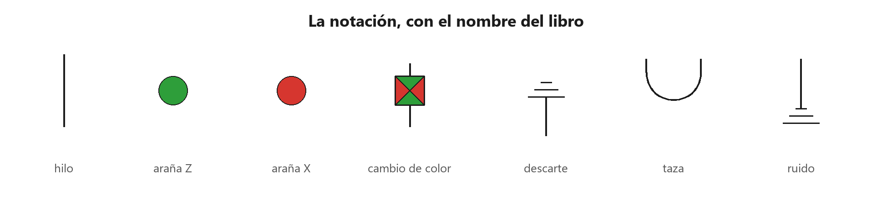
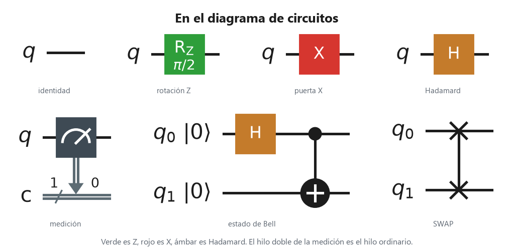

# 7. Cómo lo nombran los profesionales

Páginas 174–177. El cálculo de las arañas verdes y rojas, con el corte de patas, el estallido y la última regla, es el cálculo ZX. En la literatura, una araña es un álgebra de Frobenius especial, conmutativa y con daga. Los resúmenes de antes usan los nombres del libro. Esta página los traduce. No cambia las igualdades.

Cada marca va sola, con el nombre del libro debajo. Es el mapa de las piezas que ya aparecieron.

Los mismos nombres, dibujados como compuertas. En el circuito el tiempo va de izquierda a derecha.

La tabla se lee de izquierda a derecha. La primera columna es el libro. La segunda es la profesión. Una fila no es una regla nueva.

| Libro | Profesión |
| --- | --- |
| lotería cuántica | incertidumbre cuántica |
| rotar | transponer |
| tal vez | postseleccionado |
| seguro | causal |
| test seguro | medición de demolición |
| volteo vertical | adjunto |
| volteo horizontal | conjugado |
| se deshace al voltear | isometría |
| se deshace al voltear por los dos lados | unitario |
| fusión de tazas | intercambio de entrelazamiento |
| caja de cambio de color | compuerta de Hadamard |
| cómputo por tests cuánticos | cómputo cuántico basado en mediciones |
| no mensajear | no señalización |
| ordinario | clásico |
| taza ordinaria | correlación perfecta |
| taza cuántica | estado de Bell |
| borrado de fase | decoherencia |
| con fugas | mixto, abierto |
| sin fugas | puro, cerrado |
| no hay copia cuántica | no difusión |
| inventar un lenguaje secreto | criptografía cuántica |

Estado, test (también «efecto»), teletransporte, fase, gadget de fase y no localidad se dicen igual.
